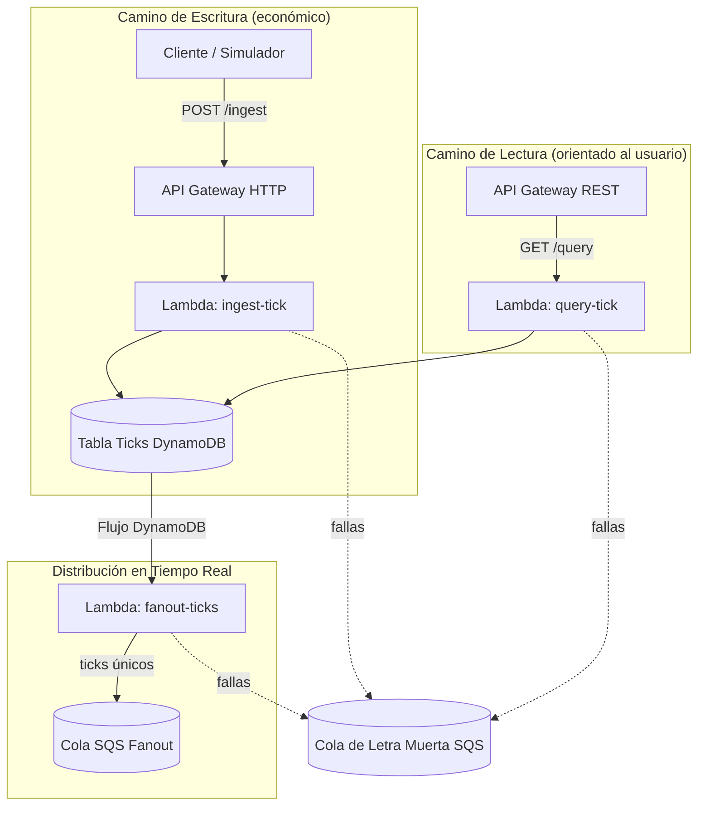

# MarketStream – Pipeline de Datos de Mercado en Tiempo Real

[](https://github.com/andreivince/aws-real-time-pipeline/actions/workflows/ci.yml)

> **En vivo en AWS • 2.3 M de invocaciones Lambda en 88 min • latencia p95 de 53 ms**
> **Costo:** ≈ $1.19 por millón de eventos (14.1 M de eventos • junio 2025)

Un **backend serverless mínimo y listo para producción** que ingiere ticks de mercado de alta frecuencia a través de AWS Lambda, los persiste en DynamoDB, **los distribuye en tiempo real** mediante DynamoDB Streams → Lambda → SQS, y demuestra que puedes soportar cargas serias por centavos.

Creado y mantenido por **Andrei Vince**.

---

## Por qué existe este proyecto 🚀

Las demostraciones “en tiempo real” de código abierto a menudo se derrumban ante tráfico más allá de lo básico o cuestan una fortuna cuando las solicitudes se acumulan. **MarketStream** demuestra que un diseño nativo de AWS puede:

* Manejar **> 30 k req / min** manteniéndose por debajo de **150 ms p95**
* Costar **< $10 / millón de solicitudes** (validado en Cost Explorer)
* Desplegarse de extremo a extremo en **un solo comando de CDK**

Úsalo como plantilla para bots de trading, picos de ETL o cualquier carga de trabajo intensiva en escritura.

---

## Características Clave 🔑

|                           |                                                                        |
| ------------------------- | ---------------------------------------------------------------------- |
| ⚡ **Rendimiento**         | 2.3 M de eventos en 88 min • 53 ms p95 • 0 errores                      |
| 💸 **Costo**               | $16.76 por 14.1 M de invocaciones → **$1.19 / M**                       |
| 🏗️ **IaC**               | Stack completo en **AWS CDK (TypeScript)**                               |
| 🔀 **Distribución en Tiempo Real**  | DynamoDB Streams → Lambda → **Cola SQS Fanout** (deduplicada)         |
| 🕸️ **APIs Duales**         | **HTTP API** `/ingest` (económica)<br>**REST API** `/query` (lista para cuotas) |
| 🔍 **Observabilidad**      | Fragmentos de CloudWatch Logs Insights incluidos                        |
| 🛡️ **Resiliencia**        | 2× reintentos + SQS DLQ en cada Lambda • caché de deduplicación basada en TTL |
| 🖥️ **Simulador de tráfico** | Script de alta frecuencia para reproducir la carga                     |

---

## Resiliencia y Manejo de Fallas 🛡️

| Mecanismo                    | Estado | Notas                                           |
| ---------------------------- | ------ | ----------------------------------------------- |
| Lambda **retryAttempts: 2**  | ✅      | Maneja fallas transitorias                       |
| **SQS DLQ** vía `onFailure`  | ✅      | Almacena eventos irrecuperables                  |
| **Caché de Deduplicación TTL**| ✅      | Previene distribuciones duplicadas al reintentar Lambda |
| Lambda de Alerta / Reproducción | ⏳   | Planificado (ver Hoja de Ruta)                   |

Ninguna carga útil se pierde silenciosamente: tras el reintento final, el evento cae en la DLQ para su inspección o reproducción manual, y los duplicados se suprimen durante 5 minutos.

---

## Arquitectura 🗺️



*La caché de deduplicación con TTL evita mensajes duplicados cuando FanoutLambda es reintentada.*

---

## Métricas Recientes 📊

| Métrica                 | Resultado                 |
| ---------------------- | ------------------------- |
| Invocaciones totales   | **2 310 000 (88 min)**    |
| Rendimiento sostenido  | **≈ 30 000 req / min**    |
| Latencia de ejecución p95 | **53 ms**              |
| Duración promedio de Lambda | 24.6 ms               |
| Latencia de escritura DynamoDB | 2.99 ms            |
| Errores / limitaciones | 0                         |

*Recopilado mediante CloudWatch Logs Insights y Paneles.*

---

## Inicio Rápido 🛠️

<details>
<summary>Prerrequisitos</summary>

* Node 18+ & npm
* AWS CLI configurado (perfil predeterminado)
* **AWS CDK v2** → `npm i -g aws-cdk`

</details>

```bash
# 1 – clonar
git clone https://github.com/andreivince/aws-real-time-pipeline
cd aws-real-time-pipeline/cdk      # La app de CDK está aquí

# 2 – instalar dependencias
npm ci                             # o npm install

# 3 – bootstrap + desplegar
npx cdk bootstrap && npx cdk deploy

# 4 – simular carga (opcional)
cd ../traffic-simulator
node sendTick.js                   # o ts-node sendTick.ts
```

Después del despliegue, copia la URL de la API impresa por CDK y crea un `.env`:

```dotenv
INGEST_ENDPOINT=https://<http‑api‑id>.execute-api.<region>.amazonaws.com/ingest
```

---

## Hoja de Ruta 🗺️ (2025‑H2)

* [x] **Lambda de Distribución** consumiendo DynamoDB Streams ← *¡hecho!* ✅
* [ ] **Emisor WebSocket** (enviar ticks a paneles)
* [ ] **Políticas IAM de menor privilegio** (eliminar AdministratorAccess)
* [x] **CI de GitHub Actions** (instalar + puerta de auditoría + test + synth)
* [ ] **Prueba rápida post-despliegue** (flujo opcional con secretos proporcionados por el usuario)
* [ ] **Alarmas de CloudWatch** vía CDK (errores > 0, costo >$5)
* [x] **Endpoint de consulta** (`/query`) para lecturas históricas ← *¡hecho!* ✅
* [ ] **Lambda de Reproducción** para vaciar la DLQ automáticamente

*Se aceptan pull requests — ver [`CONTRIBUTING.md`](docs/CONTRIBUTING.md).* 

---

## Construido Con

* **AWS Lambda** (Node 20 x86 y Graviton)
* **API Gateway** (HTTP + REST + WebSocket pronto)
* **DynamoDB** (bajo demanda, Streams ACTIVADO)
* **SQS** (Cola Fanout + DLQ)
* **AWS CDK v2** (TypeScript)

---

## Licencia 📄

[MIT](./LICENSE) — libre para bifurcar, desplegar e iterar. *¡Las estrellas y la atribución son apreciadas!*

---

> **¿Te gustó?** Dale una ⭐ al proyecto, abre un issue o escríbeme en Twitter [@byvince_](https://x.com/byvince_) — ¡se aceptan contribuciones de todos los tamaños!
